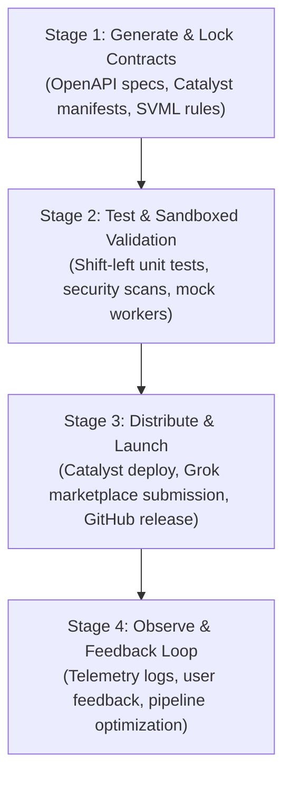

# Product Requirement Document (PRD): Autonomous Creator-Developer Arsenal

> **Governance Framework:** ACDLC v2.1.0 (Agentic Context Development Life Cycle)  
> **Coding Standard:** Karpathy Coding Guidelines (Think Before Coding, Simplicity First, Surgical Changes)  
> **Context Standard:** CDLC (Generate -> Test -> Distribute -> Observe)

---

## 1. Executive Summary
The **Autonomous Creator-Developer Arsenal** bridges rapid clean-room software reverse engineering (REA), sovereign cloud video orchestration (Zoho Catalyst + Open-Weights Video Models), and automated high-converting distribution (Hypit SVML, Agent Use Cases, Grok Plugin Marketplace). It transforms technical capability into verifiable, zero-cloud-fee sovereign software and viral audience capture.

---

## 2. Stage 0: GPS Foundation (Alignment & Intent)

### 🎯 Primary Goals
1. **Sovereign Cloud Video Studio (Flagship):** Deploy a functional, clean-room alternative to Higgsfield on Zoho Catalyst (Advanced I/O, FileStore, Queue) executing open-weights models (Wan 2.1 / LTX-Video) with 3D camera trajectory controls.
2. **Official Grok Marketplace Presence:** Submit the verified Enterprise Code & Security Auditor MCP plugin to xAI's developer marketplace.
3. **Audience & Revenue Flywheel:** Launch the 5-engine developer repository with accompanying 60-second video demo and X/Twitter mega-thread, funneling traffic to the Agent Use Cases lead magnet.

### ⚠️ Problems & Root Causes
* **Problem 1 (SaaS Lock-in & Credit Gouging):** Video AI platforms (Higgsfield, Runway, Luma) charge $30–$50/mo with strict credit depletion and data custody risks.
* **Problem 2 (Brittle Media Production):** Standard video editors desynchronize whenever voiceover scripts change.
* **Problem 3 (The Distribution Void):** Great code without a distribution engine gets zero adoption; generic marketing without code proof has zero credibility.

### 📐 Scope & Boundaries

#### In-Scope (Phase 1 Commitments)
* **Higgsfield Sovereign Gateway:** Full compatibility with extracted `hf.exe` endpoints on Zoho Catalyst serverless runtime.
* **GPU Worker Integration:** Local or serverless worker polling Catalyst Queue, applying camera vectors, and storing 1080p outputs in Catalyst FileStore.
* **Audited Codebases:** All modules must pass sub-minute shift-left tests (<5s unit tests, zero linter warnings).
* **Launch Package:** Ready-to-publish GitHub repository with MIT/Apache-2.0 license, README, and social launch assets.

#### Strict Exclusions (Out-of-Scope)
* **Training New Base Models:** We will NOT train a multi-billion parameter foundation video model from scratch; we utilize pre-trained open weights (Wan 2.1, LTX-Video, HunyuanVideo).
* **Over-Engineered Infrastructure:** No Kubernetes clusters, Kafka setups, or multi-cloud complexity until single-node Catalyst scaling is saturated (Karpathy Principle 2).

---

## 3. Success Metrics & Non-Functional Requirements (Scalar Compass $S$)

$$\text{Compass } S = \frac{\text{Test Pass Rate (100\%)} \times \text{Feature Completeness}}{\text{Cost per Render (\$0)} + \text{End-to-End Latency (s)}}$$

| Metric | Target / SLA | Verification Method |
| :--- | :--- | :--- |
| **Test Verification** | 100% pass on all harness self-tests | `pytest` / direct `--test` flags |
| **Shift-Left Speed** | < 5 seconds for local test suites | Terminal benchmark timer |
| **Catalyst API Latency** | < 250ms for job dispatch & polling | HTTP response profiling |
| **Rendering Cost** | \$0.00 cloud subscription fees | Zoho Catalyst Free Tier / Local GPU |
| **Context Window Budget** | < 30,000 active tokens per subagent lane | Context Engineering Token Monitor |

---

## 4. Governed Execution Milestones (The 4 CDLC Stages)

* [x] **Milestone 1:** REA extraction engine & clean-room OpenAPI generator.
* [x] **Milestone 2:** OmniScribe AI production web clone.
* [x] **Milestone 3:** Grok MCP Plugin manifest and verification bundle.
* [x] **Milestone 4:** Hypit SVML word-anchored compiler and player.
* [x] **Milestone 5:** Agent Use Cases curation directory.
* [x] **Milestone 6:** 1 Million Pixels interactive canvas.
* [x] **Milestone 7:** Higgsfield Sovereign Studio on Zoho Catalyst (Advanced I/O + FileStore + Worker).
* [ ] **Milestone 8:** Connect live Zoho Catalyst deployment (`catalyst deploy`) & local GPU inference runner.
* [ ] **Milestone 9:** Initialize Git repo, push public release, and execute the Creator Launch Strategy.
