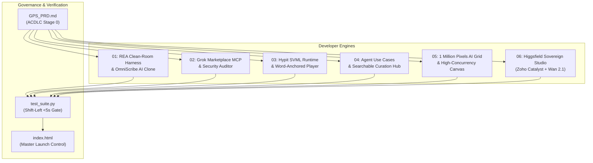

# 🚀 Autonomous Creator-Developer Arsenal

[-success?style=flat-square)](test_suite.py)
[](GPS_PRD.md)
[](https://github.com/karpathy)
[](LICENSE)

> A production-ready, sovereign suite bridging **clean-room software reverse engineering (REA)**, **serverless video AI orchestration (Zoho Catalyst + Open Weights)**, and **automated viral distribution engines**.

---

## 🏛️ System Architecture



---

## 🛠️ The 6 Production Engines

### 1. REA Clean-Room Harness & OmniScribe AI ([`01-reverse-engineer-anything/`](01-reverse-engineer-anything/))
* **`rea_runner.py`**: Extracts API endpoints and state types from network traffic/bundles into OpenAPI 3.1.0 specs.
* **`app_clone/index.html`**: A fully functional, zero-cloud-fee alternative to \$30/mo AI voice dictation tools (AudioPen / Wispr Flow) running 100% locally in-browser via Web Speech API.

### 2. Grok Plugin Connector ([`02-grok-plugin-connector/`](02-grok-plugin-connector/))
* **`plugin.json`**: Official xAI marketplace manifest compliant with [x.ai/bot/marketplace/submit-a-plugin](https://x.ai/bot/marketplace/submit-a-plugin).
* **`mcp_server.py`**: Model Context Protocol (MCP) server providing automated codebase security auditing directly in Grok chat and terminal.

### 3. Hypit SVML Video Engine ([`03-hypit-svml-video-engine/`](03-hypit-svml-video-engine/))
* **`template.svml`**: Structured Video Markup Language document where cuts, kinetic captions, and B-roll anchor dynamically to spoken words instead of brittle millisecond timestamps.
* **`svml_compiler.py`**: Compiles SVML into an interactive browser preview at `preview.html`.

### 4. Agent Use Cases Directory ([`04-agent-usecases-hub/`](04-agent-usecases-hub/))
* **`curator.py`**: High-conversion searchable directory modeled on `agentusecases.ai` with instant prompt copying and an integrated newsletter lead magnet.

### 5. 1 Million Pixels AI Grid ([`05-viral-pixel-canvas/`](05-viral-pixel-canvas/))
* **`canvas.html`**: 1,000,000-pixel digital canvas with real-time coordinate inspection, block pricing calculation (\$1/pixel), payment simulation, and 1-click viral milestone Twitter sharing.

### 6. Higgsfield Sovereign Studio ([`06-higgsfield-catalyst-replica/`](06-higgsfield-catalyst-replica/))
* **`catalyst.json`**: Zoho Catalyst project configuration (Advanced I/O, FileStore, AppSail).
* **`functions/higgsfield_api/main.py`**: Clean-room drop-in API implementing extracted Higgsfield endpoints (`/api/v1/generate`, `/api/v1/jobs/poll`, `/api/v1/soul-id/create`).
* **`worker/gpu_worker_pull.py`**: Asynchronous GPU pull worker executing open-weights models (Wan 2.1, LTX-Video, CameraCtrl 3D trajectory control).
* **`client/index.html`**: Web Studio with full Director of Photography (DoP) 3D camera controls (*Zoom, Pan, Tilt, Roll*).

---

## ⚡ Quickstart & Verification

Run the shift-left test suite to verify all engines in under 5 seconds:

```bash
# Clone the repository
git clone https://github.com/developer-creator-arsenal.git
cd developer-creator-arsenal

# Run the ACDLC Stage 5 Verification Gate (<5s SLA)
python test_suite.py
```

To open the master launch portal:
```bash
# Open index.html in any browser
start index.html
```

---

## ☁️ Deploying to Zoho Catalyst

1. **Install & Login to Catalyst CLI:**
   ```bash
   npm install -g zcatalyst-cli
   catalyst login
   ```
2. **Navigate & Deploy:**
   ```bash
   cd 06-higgsfield-catalyst-replica
   catalyst deploy
   ```

---

## 📜 License
Licensed under the Apache License, Version 2.0. See [LICENSE](LICENSE) for details.
